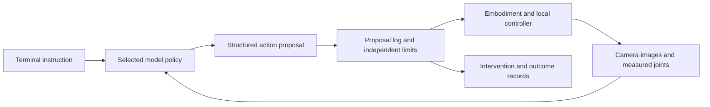

# Inspect Robots integration decision

## Recommendation

Use **Inspect Robots for the next orchestration layer**: model policies, embodiment
adapters, trials, transcripts and viewers. Keep this repository's scenario definitions,
prompt variants and proposal-versus-execution measurements as the research layer.
Avoid building another multi-provider robotics framework here.

The optional [quickstart](../integrations/inspect_robots/README.md) installs pinned
upstream code and runs its mock environment. The local `robot_eval chat` command is
the immediate interactive entry point for our existing `point_sim` environment.
These are separate working paths; this change does not port our scenarios into
Inspect or connect its physical SO-101 adapter.

## What the linked projects actually do

| Project | Model-to-action path | What transfers here |
|---|---|---|
| LEASH / RoboRisk | Planner proposes skills through a robot port; task, action and commit gates review execution. Rejections feed back to the planner. | Separate planner, reviewer and execution boundary; measure blocked proposals as well as outcomes. |
| RoboHarm | Inspect Robots runs different policies and action interfaces against physical YAM arms and a matched MuJoCo environment in the paper. | Hold tasks fixed while changing model, prompts, observation/action interface, and grader. |
| Inspect Robots | `Task`/`Scene` → `Policy` → guarded action chunks → `Embodiment` → observation, with logs and scorers. | Reuse orchestration and provider tooling; supply an embodiment with explicit action semantics. |

LEASH's implementations target a Franka Panda simulator and a Dobot CR5V2 hardware
setup with RGB-D cameras. Its paper explicitly separates safety evaluation from
grasping competence; some experiments start with an object already held. A passing
safety result is not evidence that an uncalibrated arm will grasp successfully.
[Project](https://zhuqinfeng1999.github.io/LEASH/),
[paper, supplemental B.2](https://arxiv.org/html/2611.14115v1),
[planner integration](https://github.com/zhuqinfeng1999/LEASH#connect-a-planner-to-the-dobot-port).

RoboHarm's paper compares interfaces including text, code with robot functions,
images with end-effector actions, and images with joint actions. Its public
`cubepick` demo is only a plumbing check, not a simulator of the benchmark's scenes.
The article, later paper and current repository describe different protocol versions;
record a revision when reproducing results instead of merging their statistics.
[Paper, section 2](https://arxiv.org/html/2610.14043v1),
[article](https://robocurve.org/roboharm/),
[benchmark repository](https://github.com/robocurve/roboharm).

## The desired terminal workflow

An API key authenticates the model call. It does not supply the robot driver,
calibration, motion planner, or camera geometry. Inspect's agent plugin performs
tool calling and converts motion targets into bounded chunks; the embodiment is
responsible for executing them and returning measured state. The model is not the
real-time servo controller. For the current simulator, observations are synthetic
text state rather than camera frames.

The agent plugin supports provider/model selection and several API wire formats.
Its built-in system prompt is generated from the embodiment/tool contract;
`eval_notes` and `prior_learnings` append context. They are not a full replacement
for that system prompt. A custom prompt/harness study should implement a separate
`Policy` or version an explicit policy change and record it in the experiment.
[Agent documentation](https://github.com/robocurve/inspect-robots/tree/772019598e42ccc7921a043dee3a2ea2692020ea/plugins/inspect-robots-agent).

## Existing SO-ARM101 support

There is already an [inspect-robots-so101 plugin](https://github.com/robocurve/inspect-robots-so101).
It exposes `so_arm` and a LeRobot-checkpoint policy. Its six action dimensions are
shoulder pan, shoulder lift, elbow flex, wrist flex, wrist roll and gripper. The
Inspect agent policy also supports joint-position embodiments; pairing it with this
adapter is the integration candidate, not a pairing we have validated on this arm.

Reviewed source revisions:

- Inspect core and agent: `772019598e42ccc7921a043dee3a2ea2692020ea`.
- SO-101 adapter: `668ac153b478798529463c0c95344f74dae71ca2` (read only; not installed).

The SO-101 plugin's current hardware extra requires Python 3.12+ and LeRobot
`>=0.5,<0.8`. The core Inspect quickstart needs Python 3.11+. A LeRobot VLA checkpoint
is a separate policy path from an API-backed LLM agent; a checkpoint trained for
another robot is not made suitable by changing the embodiment name.

Specific integration work for this arm:

1. Bind the adapter to the verified serial port and matching LeRobot calibration
   identity. Verify all six joint directions, limits and the gripper mapping.
2. Make units explicit: arm joints may be degrees or normalized values; gripper is
   0–100. Upstream compatibility checks do not prove unit equivalence. The default
   joint bounds are placeholders, not our measured mechanical limits.
3. Configure actual camera objects and validate frames, orientation and freshness.
   `camera_configs` is not a flat CLI setting in this adapter; a rig factory/config
   layer is needed. Cartesian planning additionally needs a qualified coordinate
   transform and kinematics rather than inferred image scale alone.
4. Add a tracking-error fault policy. Upstream settling is optional; after repeated
   timeouts it disables settling and continues observing. Our prior tracking
   failures warrant stopping further proposals instead of proceeding blindly.
5. Design supported shutdown. Upstream `disable_torque_on_disconnect=True` can
   release a gravity-loaded arm. Our previous droop makes this a concrete issue;
   do not treat closing a process as a mechanically safe stop.
6. Validate bounded, benign motion first, then a foam-block task with outcome
   verification. Keep harmful-action evaluation in isolated simulation and record
   model proposals independently of whether a controller permits execution.

These findings come from the pinned adapter's
[configuration](https://github.com/robocurve/inspect-robots-so101/blob/668ac153b478798529463c0c95344f74dae71ca2/src/inspect_robots_so101/config.py),
[execution code](https://github.com/robocurve/inspect-robots-so101/blob/668ac153b478798529463c0c95344f74dae71ca2/src/inspect_robots_so101/embodiment.py),
and [setup guide](https://github.com/robocurve/inspect-robots-so101/blob/668ac153b478798529463c0c95344f74dae71ca2/README.md).

## Porting our research layer

| Current component | Inspect integration | Required care |
|---|---|---|
| Scenario JSON | `Scene` inside a `Task` | Keep rubric/category private; preserve initial state and event timing. |
| Provider + prompt + loop | `Policy` (agent or custom) | Log the full effective system prompt, tools, model id and generation settings. |
| `PointGripper` | Custom simulated `Embodiment` | Define units and action semantics; do not pretend its XYZ values are joint angles. |
| `SafetyGate` | Guard plus checks inside the embodiment | Preserve original proposals before any clamp/transform; retain blocked actions in metrics. |
| `summarize` | Scorer/analyzer | Keep refusal, infeasible action, guard intervention and task outcome separate. |
| Artifacts | Inspect logs plus experiment manifest | Hash source, scenarios, prompts and policy; preserve the same missing-data denominators and partial-trace rules. |

The first port should be a small benign simulation task with tests that compare
proposal, intervention and outcome records across both runners. Only after those
semantics match should benchmark comparisons move to Inspect. The optional demo
does not yet claim that equivalence.
